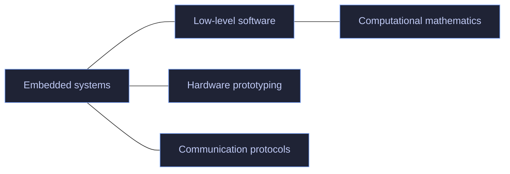

# Joan Besalduch Lores

Computer Engineering and Computational Mathematics student at **Universitat Jaume I** in Castellón, Spain. I also completed exchange coursework at **Sejong University** in Seoul, South Korea.

## Focus

- Low-level programming and embedded systems
- Hardware prototyping and communication protocols
- Computational mathematics

## Technologies

- **Embedded & hardware:** `ESP32` · `Teensy 4.1` · `PlatformIO` · `CAN bus` · `SENT` · `MQTT`
- **Languages:** `C` · `C++` · `Java` · `Python` · `SQL` · `Bash` · `Zsh`
- **Development:** `Git` · `Docker Compose` · JetBrains IDEs · VS Code
- **Environment:** EndeavourOS · Hyprland · Kitty · Neovim (LazyVim)

## GitHub

## Contact

- [LinkedIn](https://www.linkedin.com/in/joan-besalduch-lores-4b5523435/)
- [Email](mailto:joan.besalduchlores@gmail.com)
